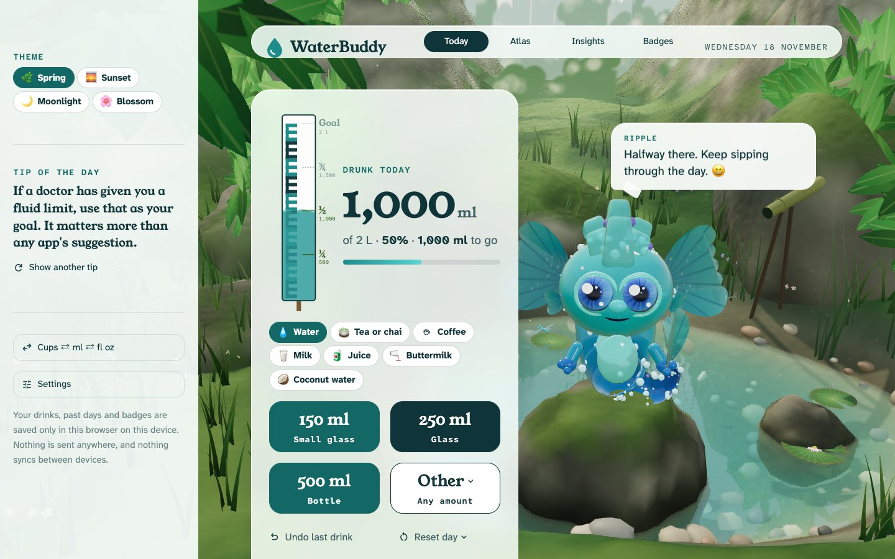
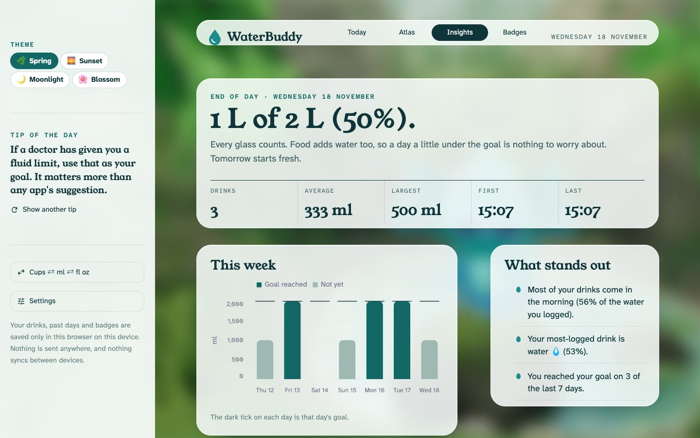
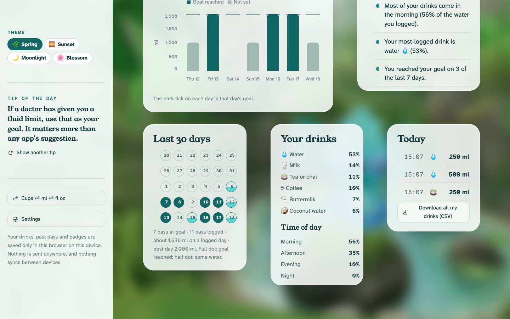
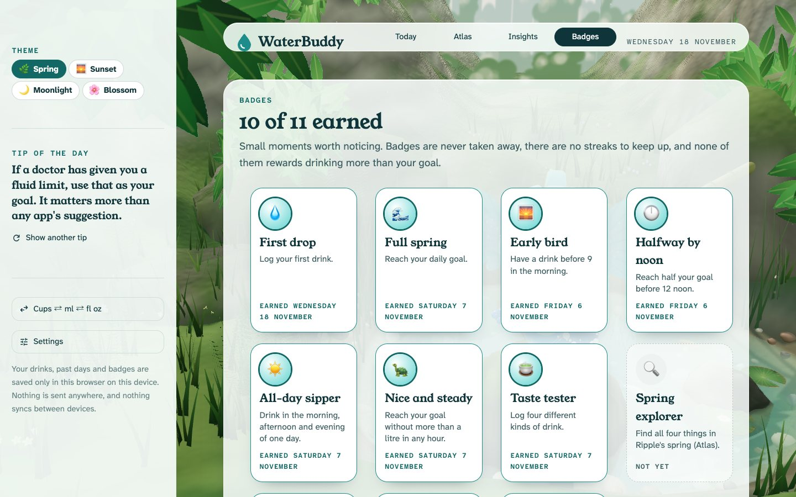
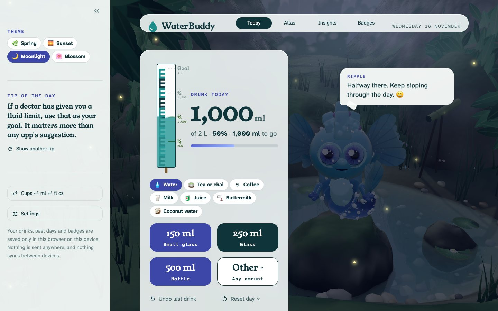
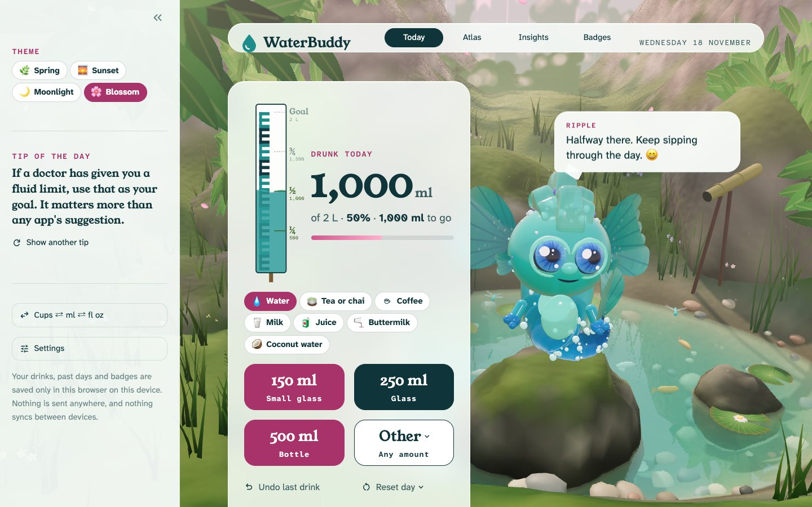
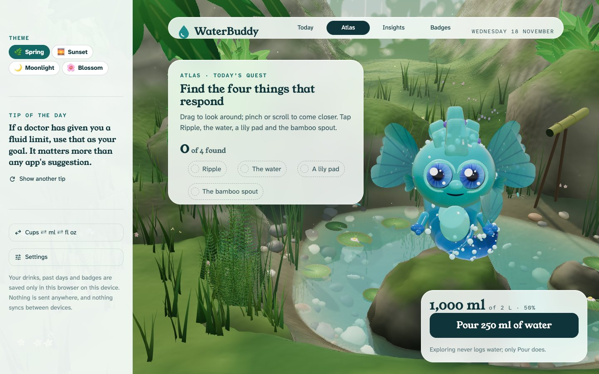
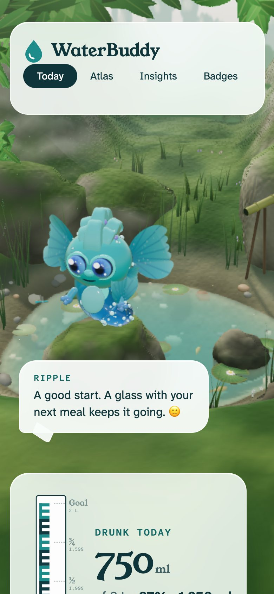
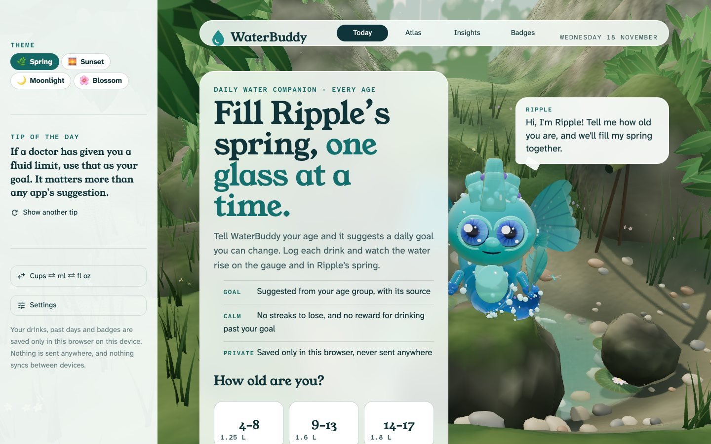

# 💧 WaterBuddy: your daily hydration companion

**FA-2 · Python Programming · Developing and Deploying an App Using Python (Streamlit)**
**Author:** Kirtan Dabhi

WaterBuddy helps you drink enough water each day, without pushing you to drink more than you need.
1. Pick your age group and WaterBuddy suggests a daily goal, with its reason and source; you can adjust it.
2. Log drinks with one tap: water, tea, coffee, milk and more. The gauge, total, percentage and Ripple's 3D spring all update live.
3. Look back on your week in **Insights**, collect **badges**, and choose a **theme** for Ripple's world.

**Live app:** _add the Streamlit Cloud link here after deploying_

<p align="center">
  
</p>

## Features, mapped to the brief

### Stage 4: Python coding and user interaction

| Requirement | How WaterBuddy does it |
|---|---|
| Select age group | Five large tiles on the welcome screen (4–8, 9–13, 14–17, 18–64, 65+), and `st.pills` in the **Your goal** card to change it later |
| Auto-suggested goal, adjustable | **Suggestion:** chosen from the age group (`waterbuddy/goals.py`), shown with its reason and source (EFSA 2010, ICMR-NIN 2024). **Adjusting:** `st.slider`. A goal outside the usual range for that age needs a tick in "Use this goal anyway" first |
| "+250 ml" button or input | **Buttons:** 150, **250** and 500 ml. **Other:** an `st.popover` with `st.number_input`; one entry over 2,000 ml is refused as a likely typo. **Undo last drink** removes the latest entry |
| Reset button | **Reset day** asks for confirmation first. A new calendar day also starts fresh automatically, and yesterday moves into history |
| *Optional:* standard vs user goal side by side | Two bars in the goal card: "Suggested 2 L" and "Your goal 2.2 L" |
| *Optional:* unit converter | **Cups ⇄ ml ⇄ fl oz** in the sidebar (`waterbuddy/units.py`) |
| Age-aware prompts | **Children (under 14):** friendlier wording, "Ask a grown-up to help you choose your goal", and a gentle note about tea and coffee. **Teens and adults:** calmer, plainer lines |
| `st.session_state` | Holds the day, age group, goal, every drink (amount, time and type), past days, badges, theme, the once-a-day celebration flag and the Atlas quest |

### Stage 5: Calculation and visual feedback

| Requirement | How WaterBuddy does it |
|---|---|
| Total so far, remaining, % achieved | `tracker.total_ml`, `remaining_ml` and `percent`. The percentage rounds down, so it reads 100% only when the goal is really met |
| Real-time progress bar or bottle | A **staff gauge** (like the depth markers in a river) drawn as SVG in `waterbuddy/gauge.py`, a progress bar, and **Ripple's 3D spring**, whose water rises as you log |
| Milestone messages and mascot reaction | **At 25, 50, 75 and 100%:** a short notice such as "+250 ml water · Halfway: 50% of your goal". Ripple's speech bubble changes, and in the 3D spring Ripple reacts to every pour. **At the goal:** a falling-drops celebration, once a day |
| *Optional:* random daily tips | 14 tips in a Python list. **Tip of the day:** a different one each day. **Show another tip:** picks one at random |
| *Optional:* compare with the standard target | The side-by-side bars above |
| Healthy-habit safety | **Over a litre in an hour:** "Sip, don't rush". **Past the goal:** drinks are logged accurately but never rewarded ("No need for more unless you're thirsty"). **Caffeine:** adults see their total against the 400 mg/day safety limit |

### Stage 6: Web app interface

| Requirement | How WaterBuddy does it |
|---|---|
| Age selector and goal display | The welcome screen, then the **Your goal** card on **Today** |
| Log button or field, progress, mascot, reset | One glass panel on **Today**: gauge and numbers, drink type, vessel buttons, Undo and Reset. Ripple's spring fills the window behind it. On phones the panels stack under the spring |
| *Optional:* sidebar with tips | Sidebar: theme, tip of the day, converter, settings |
| *Optional:* end-of-day summary | The top of **Insights**: headline, number of drinks, average and largest drink, first and last drink |
| *Optional:* mascot | **Ripple**, in an interactive 3D scene (see "How it is built") |
| Calm colours, large simple text | Fonts chosen for readability (Atkinson Hyperlegible, base size 17 px). Every theme's colours pass the WCAG AA contrast check. A **Larger text** switch is in Settings |
| Accessibility and comfort | **Reduce motion** and **Sound** switches. The **3D spring can be turned off** for slow devices, leaving the gauge and progress bar |

### Beyond the brief

#### Drink types

Pick what you're drinking before tapping a size: water, tea or chai, coffee, milk, juice, buttermilk or coconut water.
- **Every drink counts fully toward the goal.** Drinks are "water from beverages" in EFSA's reference values, and tea and coffee in normal amounts hydrate about as well as water (Maughan et al. 2016).
- **Caffeine:** tea and coffee add an approximate caffeine figure. Adults see it against EFSA's 400 mg/day limit; children get a gentle note to ask a grown-up.
- **Sugar:** juice carries a short note that water is the everyday choice.

#### Saved history and Insights

Your goal, today's drinks, past days, badges and theme are saved in **this browser's own storage** (`localStorage`), so a reload or a visit tomorrow picks up where you left off. Nothing is sent to a server.

<p align="center">
  
</p>

- **This week:** an Altair bar chart, with each day's goal marked.
- **What stands out:** short observations worked out in Python (`waterbuddy/insights.py`), such as "Most of your drinks come in the morning (56%)" or "Afternoons are quiet. A glass with lunch is an easy way to spread your water out."
- **Last 30 days:** a calendar of dots. Full: goal reached. Half: some water.
- **Your drinks** and **Time of day:** what share of your water came from each drink and each part of the day.
- **Download:** every drink as a CSV file.

<p align="center">
  
</p>

#### Badges

Eleven badges, such as **First drop**, **Early bird**, **Halfway by noon**, **Taste tester** and **Spring explorer** (`waterbuddy/achievements.py`).
- A new badge pops up as a card with a shine.
- **No streaks:** missing a day never loses anything, and badges are never taken away.
- **Nothing rewards drinking past the goal.** "Nice and steady" rewards pacing instead: reaching the goal without more than a litre in any hour.

<p align="center">
  
</p>

#### Themes

Four themes change the buttons and accents **and the mood of Ripple's world** (`waterbuddy/themes.py`): 🌿 Spring, 🌅 Sunset (warm light), 🌙 Moonlight (the world dims and fireflies drift) and 🌸 Blossom (a pink tint with falling petals).

<p align="center">
  
  
</p>

#### Atlas: exploring Ripple's spring

<p align="center">
  
</p>

- **Looking around:** drag to turn the view; pinch or scroll to zoom.
- **Today's quest:** tap Ripple, the water, a lily pad and the bamboo spout. Each find is sent back to Python. Once all four are found, the quest card fades away until tomorrow.
- **Logging:** only **Pour 250 ml** logs water; exploring never does.

#### On a phone

<p align="center">
  
</p>

_The screenshots use sample history (twelve earlier days) so that Insights and Badges have something to show._

## How it is built

```
app.py                      Streamlit interface: top bar, sidebar, the four pages, session_state, button callbacks
waterbuddy/                 the Python logic, independent of Streamlit (so it can be tested)
  goals.py                  age groups, suggested goals, usual ranges, reasons and sources
  tracker.py                Drink records; total, remaining, %, milestones, sip guard
  drinks.py                 drink types, caffeine and the caffeine note
  messages.py               Ripple's moods, milestone messages (child and adult wording), tips
  insights.py               weeks, months, parts of the day, stats and observations
  achievements.py           the 11 badges and when each was earned
  store.py                  saving to and loading from the browser (JSON), past days
  themes.py                 the four themes: colours, world filter and particles
  gauge.py                  the SVG staff gauge
  views.py                  small pieces of HTML for the page (the log, calendar, badge cards...)
  summary.py                the end-of-day summary
  units.py                  ml ⇄ cups ⇄ US fl oz
spring_component/           Ripple's 3D spring as a Streamlit custom component
  __init__.py               spring(total_ml, goal_ml, explore=..., pour=...) -> things found
  frontend/                 React + three.js source; frontend/dist is the built version Streamlit serves
storage_component/          a tiny custom component that reads and writes localStorage
assets/style.css            the glass panels, gauge, notices, badges and theme effects
tests/                      42 pytest tests for the logic (test_logic.py, test_features.py)
.streamlit/config.toml      colours and fonts
requirements.txt            streamlit, altair, pandas
```

**Logic flow (one rerun):**
1. Streamlit runs `app.py` from the top on every click.
2. `init_state()` creates the state the first time. When the date changes, it files yesterday in history and starts a new day, using the viewer's own timezone, read from the browser.
3. On the first run, the storage component reads what this browser saved last time and loads it into `st.session_state`.
4. A button's callback (`log_drink`, `undo_last`, `reset_day`) changes `st.session_state` before the page redraws, and checks for new badges.
5. The page reads the state, works out the numbers with `waterbuddy.tracker` and `waterbuddy.insights`, and draws the gauge, messages and charts.
6. The spring component gets the total, goal and latest drink, and the bamboo spout pours it. At the end of the run, the storage component saves the new state in the browser.

**The two custom components:**
- **What they are:** small web pages that Streamlit shows inside the app and talks to through `streamlit.components.v1`.
- **Who owns the data:** Python. It sends the spring the numbers on every rerun; the spring only draws them, and in Atlas it sends back which things were tapped. The storage component only saves and returns what Python gives it.
- **Why `dist/` is committed:** Streamlit Cloud runs Python only. The built files in `spring_component/frontend/dist` are committed so the app deploys without Node.js.

## Run it on your computer

Python 3.10 or later:

```bash
python -m venv .venv
source .venv/bin/activate        # Windows: .venv\Scripts\activate
pip install -r requirements.txt
streamlit run app.py
```

Then open http://localhost:8501.

**Tests:**

```bash
pip install -r requirements-dev.txt
python -m pytest -q
```

**Changing the 3D spring** (optional; needs Node.js 20+):

```bash
cd spring_component/frontend
npm install
npm run build
```

`npm run build` rebuilds `dist/`. For live editing, run `npm run dev` and start Streamlit with `WATERBUDDY_SPRING_DEV=1`.

## Deploy on Streamlit Community Cloud

1. Push this repository to GitHub (public).
2. Go to [share.streamlit.io](https://share.streamlit.io), sign in with GitHub, and click **Create app**.
3. Choose this repository, branch `main` and main file `app.py`, then **Deploy**.
4. Copy the public URL into this README and into the FA-2 submission document.

## Privacy and limits

- **Saved only in this browser:** your data lives in this browser's `localStorage` on this device. It isn't sent anywhere and doesn't sync between devices. **Settings → Delete everything** removes it.
- **No Tkinter pop-up reminders:** Tkinter opens desktop windows, which a web app on Streamlit Cloud can't do. WaterBuddy gives tips and live feedback instead.
- **WebGL needed for the 3D spring:** without WebGL it shows a still picture. On computers that draw 3D without a graphics chip, it stays still unless you choose **Show it anyway**. Logging works the same either way.
- **Caffeine figures are approximate:** they vary a lot with how a drink is made.
- **Not medical advice:** suggested goals are a starting point. A doctor's advice, for example a fluid limit, always comes first.

## Sources

- EFSA Panel on Dietetic Products, Nutrition and Allergies (2010). *Scientific Opinion on Dietary Reference Values for water.* EFSA Journal 8(3):1459. https://www.efsa.europa.eu/en/efsajournal/pub/1459
- ICMR-National Institute of Nutrition (2024). *Dietary Guidelines for Indians*, Guideline 14. https://www.nin.res.in/dietaryguidelines/pdfjs/locale/DGI_2024.pdf
- EFSA Panel on Dietetic Products, Nutrition and Allergies (2015). *Scientific Opinion on the safety of caffeine.* EFSA Journal 13(5):4102. https://www.efsa.europa.eu/en/efsajournal/pub/4102
- Maughan, R. J. et al. (2016). A randomized trial to assess the potential of different beverages to affect hydration status: development of a beverage hydration index. *American Journal of Clinical Nutrition* 103(3):717–723. https://doi.org/10.3945/ajcn.115.114769
- Streamlit documentation: https://docs.streamlit.io

## How this project was made

- **The idea and design** (age-based goals, quick logging, live feedback, the mascot and the reset) come from my **FA-1** storyboard and logic flow.
- **AI assistance:** I built this app with **Claude Code**, an AI coding assistant. It wrote much of the code, the tests and this README under my direction.
- **Reused work:** Ripple's 3D spring (React and three.js) is reused from my own WaterBuddy web app, https://waterbuddy-app-ivory.vercel.app, and wrapped as a Streamlit component for this project. Everything else is Python and Streamlit, written for FA-2.

<p align="center">
  
</p>
